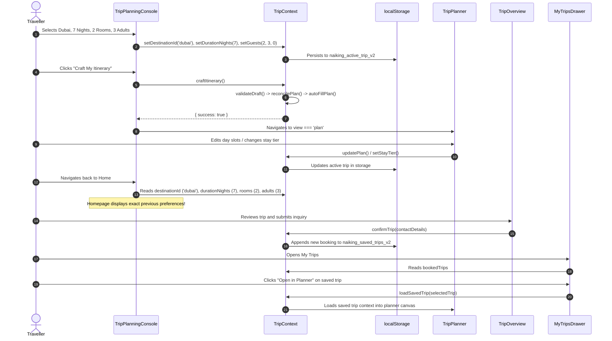
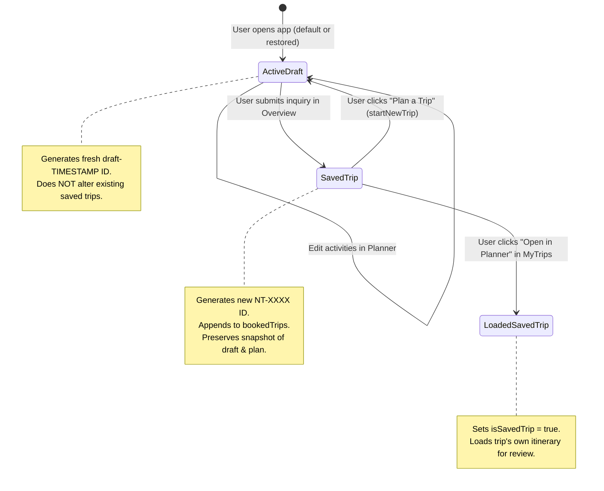

# Naikings Tours & Travels — System Architecture

This document describes the architectural design, component boundaries, state flow, and data management mechanisms of the Naikings Tours & Travels application.

---

## 1. High-Level Architectural Principles

1. **Single Authoritative Source of Truth**: The active trip configuration and plan exist in exactly one place ([TripContext.tsx](../src/context/TripContext.tsx)). All views (homepage customizer, planner, packages, overview, drawer) read from and write to this shared context.
2. **Deterministic Derivations over Redundant Storage**: Values that can be derived (e.g. `checkOut` = `departureDate` + `durationNights`, `guestSummary`, `travellerType`, `durationSummary`) are computed on demand rather than stored redundantly.
3. **Strict Separation of Temporary UI vs. Persistent Domain State**: Dropdown visibility (`activePopup`), calendar month views, and drag hover states are kept strictly local to components. Domain preferences (dates, destination, guests, filters, day activities) are stored in the persistent trip state.
4. **Resilient Persistence**: Client-side storage uses versioned keys (`naiking_active_trip_v2`, `naiking_saved_trips_v2`) with defensive data validation, stale-date advance, and graceful fallbacks.
5. **Lossless Round-Trip Synchronization**: Navigating between views, opening drawers, and reloading the browser preserves the active configuration and manual itinerary edits.

---

## 2. Component Hierarchy and View Routing

The application is structured as a single-page React 19 application in [src/App.tsx](../src/App.tsx) without an external router dependency. Views are controlled via the `activeTab` state:

```text
App (wrapped in TripProvider)
├── Header.tsx (Global navigation: Logo, Home, Destinations, Packages, My Trips, Why Naiking)
├── main (Dynamic View Switching via activeTab)
│   ├── view === 'home' | 'why'
│   │   ├── Hero.tsx
│   │   │   └── TripPlanningConsole.tsx (5-Field Holiday Customizer)
│   │   ├── CuratedPackages.tsx (Curated itinerary cards)
│   │   ├── SignatureDestinations.tsx (Destinations grid/tilt cards)
│   │   ├── HowItWorks.tsx (Service walkthrough)
│   │   ├── StandardVsNaiking.tsx (Comparative value breakdown)
│   │   └── WhyNaiking.tsx (Brand philosophy and concierge guarantee)
│   ├── view === 'plan'
│   │   ├── TripPlanner.tsx (Day-by-day Kanban board)
│   │   └── RouteMap.tsx (Leaflet interactive day route map)
│   ├── view === 'overview'
│   │   └── TripOverview.tsx (Full itinerary summary, pricing, inquiry form)
│   └── view === 'start' (TripWizard: optional deep-customization wizard)
├── Footer.tsx
├── MobileBottomNav.tsx (Mobile viewport navigation)
├── ScrollToTop.tsx
└── MyTripsDrawer.tsx (Slide-over saved trips inspector)
```

---

## 3. Shared State Architecture (`TripContext`)

### State Model Breakdown

```typescript
export interface ActiveTripState {
  id: string;                    // Stable draft identifier (e.g. "draft-1792606829")
  isSavedTrip: boolean;          // True if currently inspecting a loaded saved trip
  savedTripId: string | null;    // ID of the saved trip (e.g. "NT-8921")
  
  // 5 Homepage Customizer Fields
  destinationId: string;         // 'bali' | 'maldives' | 'dubai' | 'manali' | 'goa' | 'singapore'
  durationNights: number;        // Clamped between 1 and 14
  timingPreference: string;      // 'Upcoming Month' | 'Festive Season' | 'Serene Shoulder Season'
  departureDate: string;         // ISO date (YYYY-MM-DD)
  rooms: number;                 // >= 1
  adults: number;                // >= 1
  children: number;              // >= 0
  interests: ActivityCategory[]; // Array of selected activity categories
  stayTier: 0 | 1 | 2;           // 0 Comfort, 1 Signature, 2 Ultra Luxury

  // Domain Models
  draft: TripDraft;              // Fully formed planner draft representation
  plan: PlanState | null;        // Day-by-day activity IDs and extras
}
```

### Action Dispatchers Provided by `useTrip()`

| Dispatcher | Signature | Behavior |
| :--- | :--- | :--- |
| `setDestinationId` | `(id: string) => void` | Updates destination; reconciles or creates new plan for the new destination |
| `setDurationNights` | `(nights: number) => void` | Updates duration; recalculates checkout; reconciles plan day count |
| `setDepartureDate` | `(dateISO: string) => void` | Updates departure date; shifts checkIn/checkOut |
| `setGuests` | `(rooms, adults, children) => void` | Atomic update for accommodation and guest counts |
| `setInterests` | `(interests: ActivityCategory[]) => void` | Updates activity preferences for AI recommendation ranking |
| `setStayTier` | `(tier: 0 \| 1 \| 2) => void` | Updates stay luxury tier (Comfort, Signature, Ultra Luxury) |
| `craftItinerary` | `() => { success: boolean, error?: string }` | Validates configuration, reconciles/autofills plan, prepares for planner view |
| `startNewTrip` | `(destId?: string) => void` | Generates a new draft ID, resets to fresh clean defaults, detaches saved trip context |
| `selectPackage` | `(pkg: CuratedPackage) => void` | Seeds active trip state with package's destination, night count, and curated style |
| `loadSavedTrip` | `(trip: TripBooking) => void` | Loads a saved trip's configuration and plan into active editing mode |
| `confirmTrip` | `(contact: ContactDetails) => TripBooking` | Creates new unique booking, attaches draft/plan, saves to `bookedTrips` storage |

---

## 4. End-to-End Data Flow



---

## 5. Persistence Strategy and Safety Guarantees

### Storage Keys
- `naiking_active_trip_v2`: Active trip preferences, draft, and current `PlanState`.
- `naiking_saved_trips_v2`: Array of confirmed / booked trips.

### Defensive Validation on Hydration
When the application initializes:
1. `localStorage.getItem` is wrapped in try/catch to avoid crashes in privacy-restricted or headless environments.
2. The parsed object is validated for structure:
   - `destinationId` must match a valid destination in `PLANNER_DESTINATIONS` (defaults to `'bali'`).
   - `departureDate` must be a valid ISO string. If the stored date is in the past, it automatically advances to `today + 30 days` to prevent negative-date bugs.
   - `durationNights` is clamped between 1 and 14 days.
   - `rooms` and `adults` are validated to be $\ge 1$.
3. If stored data is corrupted or missing, clean defaults are restored silently without unhandled runtime exceptions.

---

## 6. Drafts vs. Saved Trips Lifecycle Separation

A critical requirement is that active in-progress drafts do not mutate or overwrite saved trips. The system enforces strict lifecycle boundaries:


