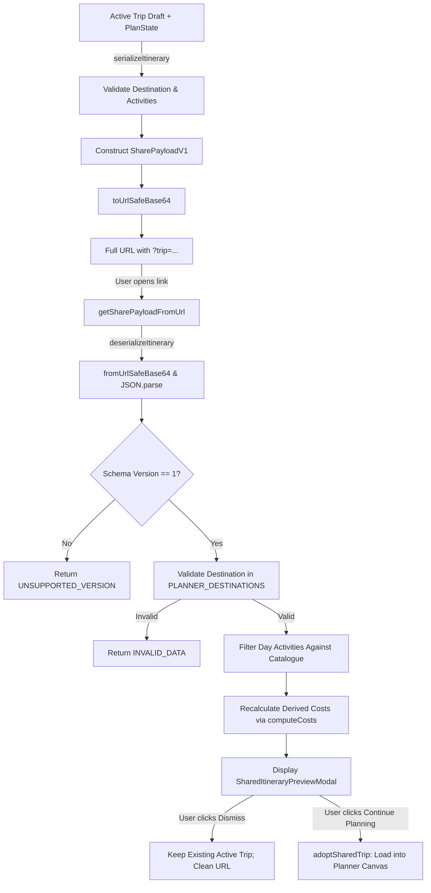

# Feature Specification: Itinerary Export & Sharing (FEAT-021)

- **Feature ID**: `FEAT-021`
- **Category**: Export & Collaboration
- **Status**: Active ✅
- **Primary Files**:
  - [src/services/shareService.ts](../../src/services/shareService.ts) — Typed serialization, encoding, decoding, validation, URL generation.
  - [src/components/PrintableItinerary.tsx](../../src/components/PrintableItinerary.tsx) — Dedicated high-contrast, printable document view.
  - [src/components/ShareItineraryModal.tsx](../../src/components/ShareItineraryModal.tsx) — Shareable link generator, clipboard copy with fallback.
  - [src/components/SharedItineraryPreviewModal.tsx](../../src/components/SharedItineraryPreviewModal.tsx) — Non-destructive preview and adoption workflow.
  - [src/index.css](../../src/index.css) — Print media stylesheet (`@media print`).
  - [src/context/TripContext.tsx](../../src/context/TripContext.tsx) — `adoptSharedTrip` mutator for safe adoption.
  - [src/App.tsx](../../src/App.tsx) — URL query parameter detection (`?trip=...`) and integration.

---

## 1. Overview & Objectives

FEAT-021 enables travellers to:
1. **Print / Save as PDF**: Generate a clean, printer-friendly, branded itinerary document via browser-native print functionality without requiring external heavy PDF libraries or server-side rendering.
2. **Shareable Itinerary URLs**: Generate a compact, URL-safe link encoding the customized itinerary so it can be shared with travel companions without requiring server-side databases, logins, or cloud storage.
3. **Non-Destructive Recipient Preview**: When a recipient opens a share link (`?trip=...`), they can review the complete day-by-day plan and live recalculated pricing in an isolated preview without overwriting their own active trip or saved bookings until they explicitly choose to adopt and customize the plan.

---

## 2. Wire Format & Schema Definition

### 2.1 Schema Version 1 (`SharePayloadV1`)

The payload uses a compact, versioned JSON structure encoded in URL-safe Base64 (RFC 4648 §5):

```typescript
export interface SharePayloadV1 {
  v: 1;                    // Schema version (always 1)
  d: string;               // destinationId (validated against canonical catalogue)
  pkg?: string;            // packageId (canonical curated package ID, if applicable)
  in: string;              // checkIn date (YYYY-MM-DD)
  out: string;             // checkOut date (YYYY-MM-DD)
  a: number;               // adults count (1 to 20)
  c: number;               // children count (0 to 10)
  r: number;               // rooms count (1 to 10)
  st: 0 | 1 | 2;           // stayTier (0=Comfort, 1=Signature, 2=Ultra Luxury)
  tp?: string;             // timingPreference (<= 50 chars)
  i: ActivityCategory[];   // travel interests (up to 6 categories)
  cids: string[];          // visited city IDs in touring order
  days: string[][];        // array of activity IDs scheduled per day
  veh?: string;            // customized transfer vehicle (<= 60 chars)
}
```

### 2.2 Fields Excluded for Privacy & Integrity
The following are strictly excluded from the serialization boundary:
- **No Personal Contact Information**: Full name, email address, and phone number are never serialized.
- **No Enquiry Messages or Notes**: Custom messages, special requests, and callback notes are excluded.
- **No Private Booking Identifiers**: Confirmed booking IDs (`NT-xxxx`) and customer records are not included.
- **No Local Storage Contents**: Unrelated saved trips, wishlist items, or authentication tokens are excluded.
- **No Client Prices**: Prices are never serialized or accepted from the wire format. All prices are deterministically recalculated by `computeCosts` from the canonical destination catalogue.

### 2.3 Payload Size & Limits
- **Maximum Payload Length**: 8,192 characters (payloads exceeding this limit are rejected safely).
- **Typical Payload Size**: 300–600 characters of base64 text for a 5-to-7 day trip, well below browser URL limits (2,000+ characters).

---

## 3. Serialization & Deserialization Flow



---

## 4. Print / PDF Export Specification

### 4.1 Native Browser Print Integration
- **Invocation**: Triggered via `window.print()` from:
  1. `TripOverview.tsx` (Top bar and Price card)
  2. `TripPlanner.tsx` (Top action bar)
  3. `SharedItineraryPreviewModal.tsx` (Modal footer)
- **User Instruction**: Clearly communicates: *"Print itinerary or save as PDF via your browser's print dialog"*.

### 4.2 Document Structure (`PrintableItinerary.tsx`)
1. **Header**: Naikings Tours brand wordmark, bespoke private journey tagline, concierge contact details (+91 98765 43210, concierge@naikingtours.com), and export timestamp.
2. **Trip Identity**: Curated package name or tailor-made destination title, travel dates, traveller breakdown, stay tier, and selected private vehicle.
3. **Logistics Summary**: Day 1 arrival pickup and final departure drop arrangements.
4. **Day-by-Day Itinerary**:
   - Numbered day badges with calendar dates and touring city.
   - Chronological activities showing time slots, duration, category, and descriptive summary.
   - Empty days explicitly noted as *"Free day for relaxation and leisure at resort"*.
5. **Itemized Estimated Cost Breakdown**:
   - Boutique stay
   - Private chauffeured transfers
   - Curated experiences & admissions
   - Dedicated concierge service fee (5%)
   - Total estimated price and per-guest breakdown
   - Mandatory price disclosure notice.

### 4.3 Print Styling (`@media print`)
- **Interactive Elements Hidden**: Header, footer, navigation bars, bottom nav, edit/remove buttons, modals, toasts, drag handles, search bars.
- **Print Optimization**: High contrast text (`#16222E`), pure white background, page margins (1.2cm), `-webkit-print-color-adjust: exact`.
- **Page Break Avoidance**: `.print-avoid-break` applied to day cards and cost breakdown blocks to avoid split sections across page boundaries.

---

## 5. Recipient Preview & Adoption Workflow

1. **URL Parameter Detection**: `App.tsx` inspects `window.location.search` on mount and on `popstate` events using `getSharePayloadFromUrl()`.
2. **Isolated Preview State**: The decoded itinerary is placed into `sharedTripPreview` state. The user's existing `activeTrip`, `bookedTrips` list, and `savedPackages` wishlist remain completely untouched.
3. **Explicit User Choice**:
   - **Continue Planning / Customise**: Invokes `adoptSharedTrip(sharedDraft, sharedPlan)`, which adopts the draft into the active planner canvas, clears the URL query parameter via `window.history.replaceState`, and navigates to `view === 'plan'`.
   - **Keep My Existing Trip / Dismiss**: Cleans the URL parameter and closes the preview without modifying any active or saved state.

---

## 6. Testing & Validation

Automated test suites in `scripts/verify-features.ts`:
- **Group 9**: Serialization & Deserialization round-trips, URL extraction, version checks, malformed base64/JSON rejection, oversized payload protection, and PII exclusion.
- **Group 10**: Derived pricing recalculation, tampered price rejection, unknown activity ID pruning, unknown destination rejection, and duration clamping (1–14 nights).
- **Group 11**: State isolation during preview, booked trips and wishlist immutability, adoption workflow, and repeated adoption idempotency.
- **Group 12**: Empty itinerary handling, cost calculations with 0 activities, printable view data integrity, and non-mutation of application state during export.
