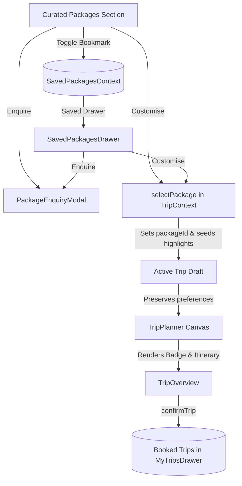

# Feature: Package Discovery-to-Planning Journey Integration

- **Feature ID**: `FEAT-020`
- **Category**: Discovery & Journey Integration
- **Status**: Active ✅
- **Primary Files**:
  - `src/context/TripContext.tsx`
  - `src/components/TripPlanner.tsx`
  - `src/components/CuratedPackages.tsx`
  - `src/components/SavedPackagesDrawer.tsx`
  - `src/components/PackageEnquiryModal.tsx`
  - `src/types.ts`
  - `src/App.tsx`

---

## 1. Overview & Purpose

The **Package Discovery-to-Planning Journey Integration** unites curated travel package discovery, bookmarking (Save for Later), lead consultation (Package Enquiry), and interactive itinerary planning into a seamless, robust, and state-preserving user journey.

It ensures that:
- Packages retain their canonical identity (`packageId`) across all workflow stages, including active planning and saved trip bookings.
- Customizing a package transfers canonical destination, duration, and baseline signature activities into the itinerary planner.
- Unrelated user preferences (such as travel party size, departure date, timing preference, and stay style) are preserved when customizing a package rather than being unexpectedly reset.
- Save for Later wishlists, active trip drafts, and confirmed trip bookings remain strictly isolated and cannot unexpectedly overwrite each other.
- Enquiries initiated from package cards or saved packages remain anchored to the target package's context, independently of whatever active trip draft may be currently in memory.

---

## 2. Key Capabilities

1. **Canonical Package Identity (`packageId`)**:
   - `TripDraft` and `ActiveTripState` carry `packageId?: string | null`.
   - On hydration from `localStorage`, `packageId` is validated against `CURATED_PACKAGES` to prune obsolete or corrupt IDs gracefully.
   - When a customized package is confirmed as a concierge request, `TripBooking` stores `packageId` and retains the package's canonical title (`"[Package Name] (Customized)"`).

2. **Preference Preservation During Customization**:
   - When `selectPackage(pkg)` is invoked from a card or the Saved Packages drawer, existing valid preferences for `rooms`, `adults`, `children`, `departureDate`, `timingPreference`, and `stayTier` are preserved.
   - If user interests are set, they are preserved; otherwise, relevant interests are derived from `pkg.category` (Beach, Mountains, Luxury, Culture).

3. **Signature Highlights Seeding**:
   - Package highlights are parsed and matched against destination catalogue activities via keyword extraction.
   - Matching signature experiences are seeded as anchor activities across the package's days before automated balancing with `autoFillPlan`.

4. **Visual Context in Planner**:
   - `TripPlanner.tsx` renders a prominent context badge (`"Customising: [Package Name]"`) when `draft.packageId` resolves to a canonical curated package.

5. **Defensive Error Handling**:
   - Validates package destination against `PLANNER_DESTINATIONS`, falling back to safe defaults if an invalid destination is supplied.
   - Clamps duration nights within supported bounds (1–14).
   - `TripPlanner.tsx` uses a safe fallback (`getDestination(draft.destinationId) || PLANNER_DESTINATIONS[0]`), preventing runtime crashes.

6. **Race-Condition-Free Save for Later Toggling**:
   - `toggleSavePackage` in `SavedPackagesContext.tsx` uses an atomic functional state updater (`setSavedItems(prev => ...)`), guaranteeing deduplication and avoiding stale-closure race conditions under rapid repeated clicking.

7. **Modal Cleanup on Navigation**:
   - Navigation to the planner or selecting a package resets `enquiryPackage` to `null`, preventing orphan modals from floating over planner canvases.

---

## 3. Data Flow Architecture

---

## 4. Verification & Testing

Tested across 74 automated test assertions covering:
- Canonical package ID tracking in draft and bookings.
- User preference preservation on package customization.
- Package highlights matching and itinerary generation.
- Complete isolation of Saved Packages wishlist, Active Trip draft, and Saved Trips bookings.
- Defensive handling of corrupt `localStorage` and invalid destination IDs.
- Rapid repeated click deduplication.
- End-to-end browser subagent verification across desktop and mobile viewports.
