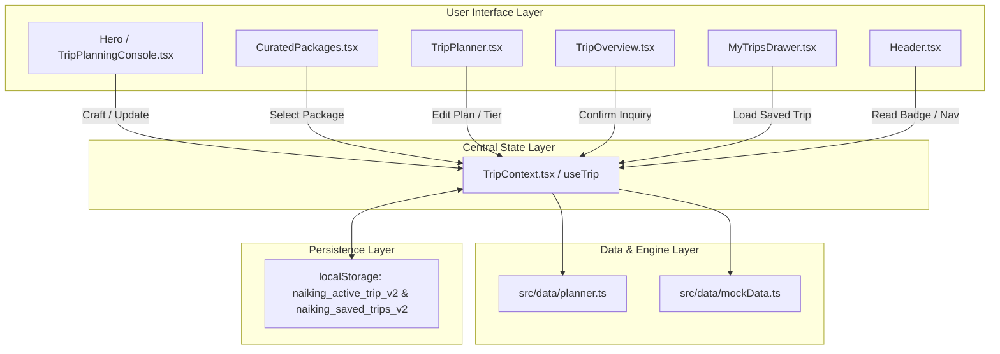

# Naikings Tours & Travels — Project Overview

## 1. Mission and Value Proposition

**Naikings Tours & Travels** is a quiet-luxury bespoke travel agency platform. It delivers an end-to-end, high-touch holiday planning experience designed around the traveller. Rather than forcing users through generic booking funnels or rigid pre-packaged tours, Naikings combines curated boutique luxury inventory (villas, private chauffeured transfers, signature cultural experiences) with an interactive, day-by-day itinerary planning canvas.

The platform's core motto is **"A Journey Designed Around You"**, operating on three central pillars:
1. **Curated Luxury**: Private chauffeured transit, handpicked boutique villas, and zero hidden markups.
2. **Direct Customization**: Fast, 5-field holiday configuration right on the homepage, immediately seeding a custom interactive itinerary.
3. **Concierge-Backed Execution**: Day-by-day itinerary control with real-time cost transparency, connected to a private concierge inquiry workflow.

---

## 2. Technology Stack

Verified directly from [package.json](../package.json) and project configuration:

| Category | Technology | Version | Role / Purpose |
| :--- | :--- | :--- | :--- |
| **Core Framework** | [React](https://react.dev/) | `^19.0.1` | Client UI library, component model, Context API |
| **Language** | [TypeScript](https://www.typescriptlang.org/) | `^7.0.2` | Type safety, domain model definitions, compile-time checks |
| **Build Tooling** | [Vite](https://vitejs.dev/) | `^8.3.0` | Fast dev server, Rollup production bundling |
| **Styling** | [Tailwind CSS v4](https://tailwindcss.com/) | `^4.3.3` | Utility styling via `@tailwindcss/vite` |
| **Typography** | Google Fonts | Web | *Marcellus* (editorial luxury serif), *Jost* (modern geometric sans) |
| **Motion** | [Motion (Motion for React)](https://motion.dev/) | `^12.23.24` | Ken-burns transitions, wandering flight path, smooth reveals |
| **Icons** | [Lucide React](https://lucide.dev/) | `^0.546.0` | Standardized icon library |
| **Maps** | [Leaflet](https://leafletjs.com/) | `^1.9.4` | Interactive day route map visualization in `RouteMap.tsx` |
| **AI Integration** | [@google/genai](https://www.npmjs.com/package/@google/genai) | `^2.4.0` | Server-assisted activity suggestions with local rule-based fallback |
| **Persistence** | Browser `localStorage` | Native | Versioned client-side draft and saved trip state |

---

## 3. Supported Destinations

The platform currently models 6 signature global and domestic sanctuaries in [src/data/planner.ts](../src/data/planner.ts) and [src/data/mockData.ts](../src/data/mockData.ts):

| Destination ID | Name | Country | Regional Tag | Curated Activity Catalog |
| :--- | :--- | :--- | :--- | :--- |
| `bali` | Bali | Indonesia | Tropical & Cultural | Rice terrace sunrises, Tirta Empul purification, Kecak fire dances, private villas |
| `maldives` | Maldives | Indian Ocean | Overwater Sanctuary | Lagoon bungalows, reef snorkel safaris, private sandbank picnics, floating breakfasts |
| `dubai` | Dubai | UAE | Skyline & Desert Oasis | Burj Khalifa Level 148, private dune safaris, souk tours, marina yacht dinner cruises |
| `manali` | Manali | India | Alpine Cedar & Peaks | Alpine chalets, cedar forests, mountain passes, local cultural walks |
| `goa` | Goa | India | Heritage & Coast | Indo-Portuguese estates, quiet coves, spice plantations, coastal dining |
| `singapore` | Singapore | Southeast Asia | Skyline & Michelin Cuisine | Marina Bay skyline, Gardens by the Bay, Michelin hawker crawls, boutique city stays |

---

## 4. Main User Journeys

### Journey 1: Homepage Customizer to Instant Itinerary
1. Traveller enters the homepage and views the **Holiday Packages & Customiser** console.
2. Selects destination, duration, departure date, rooms, guests, and vibe filters.
3. Clicks **Craft My Itinerary**.
4. System validates inputs and transitions directly into the interactive **Itinerary Planner** (`TripPlanner`), populated with intelligent AI activity recommendations for each day.
5. Returning to the homepage at any point restores the exact selected preferences without data loss.

### Journey 2: Curated Package Customization
1. Traveller scrolls to **Curated Packages** on the homepage.
2. Selects a signature package (e.g., *Kamandalu Rainforest & Ocean Sanctuary*).
3. Clicks **Customise Itinerary**.
4. Active trip state is initialized with the package's destination, night count, and curated style.
5. Traveller is routed directly to `TripPlanner` with that itinerary ready for fine-tuning.

### Journey 3: Interactive Itinerary Editing & Inquiry Submission
1. In the planner, the traveller drags experiences across morning, afternoon, and evening slots, toggles stay tiers (Comfort, Signature, Ultra Luxury), and explores the Leaflet route map.
2. Clicks **Review Trip Overview** to see itemized cost breakdowns and day schedules.
3. Submits contact details to initiate a concierge request.
4. The inquiry is assigned an ID (e.g. `NT-8421`), added to **My Trips**, and persisted to local storage.

### Journey 4: Saved Trips Inspection & Resumption
1. Traveller clicks **My Trips** in the floating header.
2. A slide-over drawer displays upcoming and past concierge journeys.
3. Clicking **Open in Planner** loads that specific trip's configuration and itinerary back into active editing mode.

---

## 5. Architectural Map

---

## 6. Current Project Scope & Limitations

1. **Client-Side Persistence Only**: State persistence relies on browser `localStorage`. Trips persist reliably across reloads and tab navigations on the same client, but there is currently no backend database or cross-device cloud synchronization.
2. **Inquiry-Based Booking**: Submitting a trip via `TripOverview` creates a `'Preparing'` concierge booking request. The application deliberately does not process real payment transactions or live airline GDS ticketing.
3. **Single-Page Tab Navigation**: The app uses React state-driven tab switching (`'home' | 'why' | 'start' | 'plan' | 'overview'`) rather than URL-based pushState routing (`react-router` is not installed).
