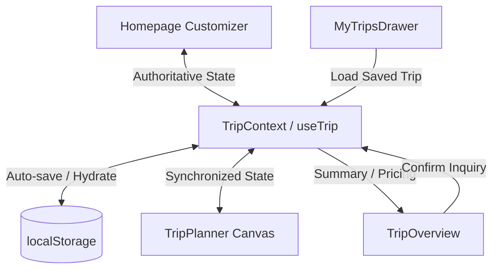

# Task: Centralized Trip State, Cross-Page Synchronization & Persistence

- **Date**: 2026-10-22
- **Status**: Completed ✅
- **Related Feature**: [Trip State Management](../FEATURES/trip-state-management.md)
- **Primary Source Files**:
  - `src/context/TripContext.tsx` *(New)*
  - `src/App.tsx`
  - `src/types.ts`
  - `src/components/TripPlanningConsole.tsx`
  - `src/components/MyTripsDrawer.tsx`
  - `src/components/CuratedPackages.tsx`
  - `src/components/Header.tsx`

---

## 1. Problem Statement

Before this task, trip planning behaved as isolated, fragmented steps rather than one continuous experience:
1. **Disconnected State**: The homepage customizer had its own local state. When users configured a trip and clicked **Craft My Itinerary**, the app launched `TripWizard` at Step 3/4, asking the user to choose cities and dates all over again.
2. **Loss of Selections on Navigation**: Returning to the homepage from the planner wiped all selections, resetting the customizer to hardcoded default values.
3. **No Browser Refresh Persistence**: Refreshing the browser wiped the entire in-progress itinerary draft and reset state to `newDraft()`.
4. **No Saved Trip Resumption**: Trips in `MyTripsDrawer` could only be viewed as read-only cards; there was no way to reload a saved trip back into the interactive planner canvas.

---

## 2. Requirements

1. Establish one authoritative source of truth for the active trip draft.
2. Eliminate duplicate configuration forms when preferences have already been provided on the homepage.
3. Preserve all user selections during navigation between Home, Planner, Destinations, Packages, and My Trips.
4. Persist active drafts across component remounts and browser refreshes using versioned client storage.
5. Keep the active draft strictly separate from independently saved trips.
6. Allow saved trips to be loaded back into the interactive planner canvas.
7. Preserve the existing itinerary planner, Leaflet route map, pricing calculations, AI suggestions, and trip overview.
8. Validate dates and guest configurations defensively.

---

## 3. Implementation Details

### A. Central State Store ([src/context/TripContext.tsx](../../src/context/TripContext.tsx))
Created `TripContext` and custom hook `useTrip()` to manage:
- Customizer fields: `destinationId`, `durationNights`, `timingPreference`, `departureDate`, `rooms`, `adults`, `children`, `interests`, `stayTier`.
- Domain models: `draft: TripDraft` and `plan: PlanState | null`.
- Saved trips: `bookedTrips: TripBooking[]`.
- Active draft metadata: `activeTripId`, `isSavedTrip`, `savedTripId`.

### B. Direct Planner Entry via `craftItinerary()`
When the traveller clicks **Craft My Itinerary**:
1. `craftItinerary()` validates the active draft via `validateDraft(draft)`.
2. Reconciles existing plan state via `reconcilePlan(plan, draft)`.
3. Auto-fills empty day slots with AI recommendations via `autoFillPlan(draft, basePlan)`.
4. Navigates directly to `view === 'plan'`.
5. Bypasses the redundant 5-step `TripWizard`.

### C. Client Storage Persistence
- Implemented `localStorage` sync on state updates for `naiking_active_trip_v2` and `naiking_saved_trips_v2`.
- Safe hydration: If a saved departure date is before `todayISO()`, the date is automatically advanced to `today + 30 days` to prevent past-date scheduling issues.
- Destination ID is validated against `PLANNER_DESTINATIONS` with a safe fallback to `'bali'`.

### D. Saved Trips Lifecycle Separation
- `startNewTrip()`: Resets to a fresh draft with a unique `draft-TIMESTAMP` ID and sets `isSavedTrip: false`.
- `loadSavedTrip(trip)`: Sets `isSavedTrip: true`, `savedTripId: trip.id`, and restores the trip's draft and plan into the planner.
- `confirmTrip(contact)`: Creates a new `TripBooking` with unique `NT-XXXX` ID, attaches the draft and plan, and prepends to `bookedTrips`.

---

## 4. Files Created or Modified

| File Path | Status | Role |
| :--- | :--- | :--- |
| `src/context/TripContext.tsx` | Created | Central state provider, persistence engine, and action dispatcher. |
| `src/types.ts` | Modified | Added `id?: string`, `timingPreference?: string` to `TripDraft`; added `draft?: TripDraft`, `plan?: PlanState` to `TripBooking`. |
| `src/App.tsx` | Modified | Wrapped app in `<TripProvider>`; replaced local draft/plan state with `useTrip()`. |
| `src/components/TripPlanningConsole.tsx` | Modified | Bound all 5 fields directly to `useTrip()`; connected **Craft My Itinerary** to `craftItinerary()`. |
| `src/components/MyTripsDrawer.tsx` | Modified | Added **Open in Planner** action button to saved trip cards. |
| `src/components/Hero.tsx` | Modified | Added `onCraftItinerary` callback and forwarded to console. |
| `src/components/Header.tsx` | Modified | Removed redundant `Plan a Trip` button from navigation bar. |

---

## 5. End-to-End Data Flow

---

## 6. Testing and Validation

### Automated Verification
- `npm run lint` (`tsc --noEmit`): **0 errors** ✅
- `npm run build` (`vite build`): **Built successfully in 402ms** ✅

### Browser Subagent End-to-End Test Scenarios

| Scenario | Test Procedure | Observed Result | Status |
| :--- | :--- | :--- | :--- |
| **Scenario A** | Select Dubai, 7 Nights, 2 Rooms, 3 Adults $\rightarrow$ click Craft My Itinerary | Navigated directly to `TripPlanner` with Dubai, 8 days, 3 guests; no wizard shown | **Passed ✅** |
| **Scenario B** | From planner, click Home in header | Homepage customizer restored: Dubai, 7 Nights, 2 Rooms · 3 Adults | **Passed ✅** |
| **Scenario C** | Change destination to Maldives on homepage $\rightarrow$ click Craft My Itinerary | Planner opened with Maldives destination and synchronized duration | **Passed ✅** |
| **Scenario D** | Refresh browser (`location.reload()`) | Active draft and preferences restored from `localStorage` without data loss | **Passed ✅** |
| **Scenario E** | Open My Trips $\rightarrow$ click "Open in Planner" on saved trip | Loaded saved trip itinerary into planner; returning Home reflected trip context | **Passed ✅** |
| **Scenario F** | Navigate to Destinations, Packages, Why Naiking | Navigation smooth; no active draft resets | **Passed ✅** |
| **Scenario G** | Planner drag-and-drop, stay tiers, Leaflet route map, pricing | All interactive planner features operated cleanly without regressions | **Passed ✅** |

---

## 7. Known Limitations

- **Browser-Bound Persistence**: Persistence is scoped to the browser client via `localStorage`. Multi-device synchronization requires future cloud user authentication.
- **Historical Mock Trips**: Initial mock trips from `mockData.ts` (Dubai `NT-8921` and Goa `NT-6714`) did not contain serialized `PlanState` objects; they are reconstructed using rule-based defaults when loaded. Newly submitted inquiries retain 100% lossless plan snapshots.
