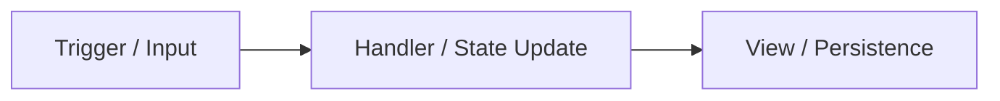

# Task: [Task Title]

- **Date**: YYYY-MM-DD
- **Status**: [Proposed | In Progress | Completed | Deferred]
- **Related Feature**: [Feature Name](../FEATURES/[feature-file].md)
- **Primary Source Files**:
  - `src/...`
  - `src/...`

---

## 1. Problem Statement

Describe what was missing, broken, inconvenient, or inconsistent before this work. Explain the business, user experience, or architectural justification for the change.

---

## 2. Requirements

List the non-negotiable and functional requirements for this task:
- Requirement 1
- Requirement 2
- Requirement 3

---

## 3. Implementation Details

Explain the changes made, the design decisions, and how the feature works in practice.

### Key Changes
1. **Component / Module Changes**: Detail the specific updates.
2. **State & Logic Changes**: Explain how state transitions and logic were modified.
3. **UI / UX Refinements**: Detail visual, layout, and interaction changes.

---

## 4. Files Created or Modified

| File Path | Status | Description of Changes |
| :--- | :--- | :--- |
| `src/...` | Modified | ... |
| `src/...` | Created | ... |

---

## 5. State and Data Flow

Describe how data enters, moves through, and is persisted or synchronized across the application for this task. Include Mermaid sequence or flow diagrams where appropriate.

---

## 6. Testing and Validation

Record both automated and manual verification performed:
- **Typecheck**: Command executed and result (e.g. `npm run lint`).
- **Build**: Command executed and result (e.g. `npm run build`).
- **Functional Scenarios**: Specific user journeys and interactive tests executed.
- **Verification Status**: [Verified in environment | Reported / Pending | Not verified]

---

## 7. Known Limitations and Deferred Work

Document any trade-offs, scope boundaries, or items intentionally deferred to future tasks:
- Limitation 1
- Deferred Item 2

---

## 8. Acceptance Criteria Matrix

| Criterion | Status | Evidence / Verification Method |
| :--- | :--- | :--- |
| [Criterion 1] | Verified ✅ | ... |
| [Criterion 2] | Verified ✅ | ... |

---

## 9. Related Documentation

- [Project Overview](../PROJECT_OVERVIEW.md)
- [Architecture Overview](../ARCHITECTURE.md)
- [Feature Inventory](../FEATURE_INVENTORY.md)
- [Development Log](../DEVELOPMENT_LOG.md)
- [Changelog](../CHANGELOG.md)
